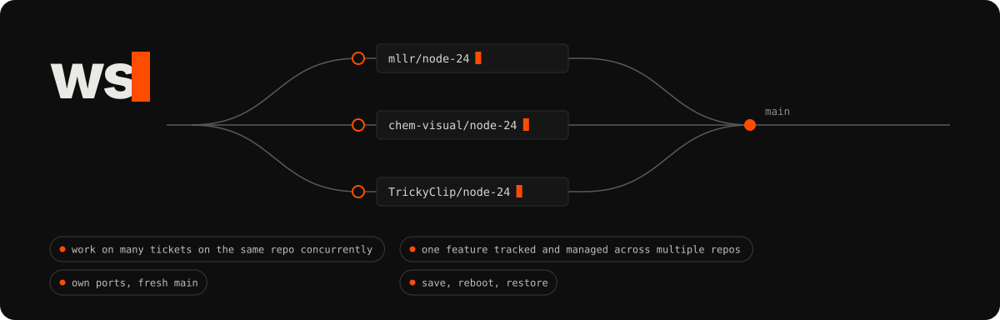

<a href="https://mllr.ca/media/ws-music.mp4"></a>

# ws

work on many tickets on the same repo concurrently



## Install

macOS, Linux, Git Bash or WSL

```
git clone https://github.com/Milllr/ws-workspaces.git && bash ws-workspaces/install/install.sh
```

Windows PowerShell

```
git clone https://github.com/Milllr/ws-workspaces.git; powershell -ExecutionPolicy Bypass -File ws-workspaces\install\install.ps1
```

Open a new terminal and you're set.

```
ws -n my-branch
```

[the full reel](https://mllr.ca/media/ws-music.mp4) · [every command](docs/MANUAL.md)
